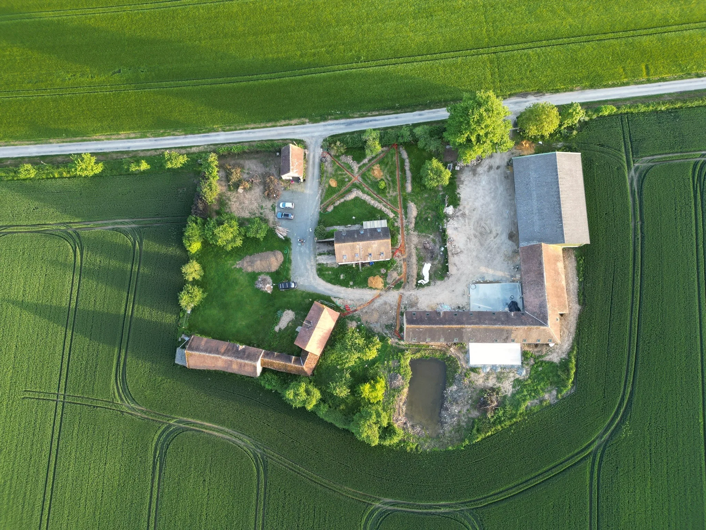

  

# Villa Perchée : maison privatisée pour groupes dans le Perche

**45 couchages. Piscine chauffée. Padel privé. Bain nordique. 1h30 de Paris.**

Un corps de ferme du XIXe dans le Parc naturel régional du Perche, loué en entier à un seul groupe. Cousinades, anniversaires, mariages intimistes, séminaires résidentiels. Ouverture en mars 2027.

[Voir la maison](https://www.villaperchee.com/) · [Demander un devis](https://www.villaperchee.com/devis-contact/) · [Questions fréquentes](https://www.villaperchee.com/faq-villa-perchee/)

---

## Pourquoi on a construit ce lieu

Au départ, une bande de copains. Une vingtaine. Puis les +1, les enfants, les amis d'amis. On est vite passés à 40.

Chaque année, même problème. La maison avait la piscine mais pas la place. L'autre avait la place, et 2 pages de règlement intérieur scotchées dans la cuisine. Et toujours ce propriétaire qui débarque à 23h parce que quelqu'un chante trop fort.

Ce lieu, on ne l'a pas trouvé. Alors on l'a créé.

On a signé en 2025 : 2 granges en pierre, une maison des années 70, 7000 m² de terrain. Sols en terre battue, ni eau ni électricité. Le gros œuvre est confié à des artisans du coin. Les cuisines, les salles de bains et les sols, on les fait nous-mêmes, le week-end. On a douté. Et on a continué.

L'histoire complète : [le manifeste](https://www.villaperchee.com/blog/le-manifeste/) et [le récit du chantier](https://www.villaperchee.com/blog/histoire-chantier/).

## Ce qu'il y a sur place

| | |
|---|---|
| Couchages | 45, répartis en plusieurs chambres et espaces |
| Terrain | 7000 m², sans voisin à proximité |
| Baignade | [Piscine chauffée](https://www.villaperchee.com/activites/piscine/) |
| Sport | [Terrain de padel privé](https://www.villaperchee.com/activites/padel/), ping-pong, pétanque |
| Détente | [Bain nordique](https://www.villaperchee.com/activites/bain-nordique/), brasero |
| Fête | [Salle festive avec bar](https://www.villaperchee.com/activites/salle-festive/) |
| Travail | Salle de réunion jusqu'à 45 personnes |
| Accès | 1h30 de Paris en voiture, 10 min de Nogent-le-Rotrou |
| Séjour | 2 nuits minimum |

Tout est privatisé. Pas de créneau à réserver, pas d'autre groupe au bord de la piscine. Accès de plain-pied partout, pour les grands-parents comme pour les poussettes.

## Pour qui

**La cousinade qu'on repousse depuis 2 ans.** 3 générations sous le même toit, les enfants qui courent dans le jardin, une cuisine assez grande pour cuisiner à 40 sans se marcher dessus. [Cousinade et réunion de famille](https://www.villaperchee.com/evenements/cousinade-reunion-famille/)

**Les 40 ou les 50 ans.** Pas de voisins. Pas de couvre-feu. Ta fête, tes règles. [Anniversaire](https://www.villaperchee.com/evenements/anniversaire/)

**Le mariage à taille humaine.** Les proches dorment sur place. Le lendemain, personne ne reprend la route avant le brunch. Jusqu'à 80 invités, sur devis. [Mariage intimiste](https://www.villaperchee.com/evenements/mariage/)

**Le séminaire qui sort du bureau.** Réunion le matin, padel l'après-midi, bain nordique avant le dîner. [Séminaire et team building](https://www.villaperchee.com/evenements/seminaire-team-building/)

Et aussi : [EVG / EVJF](https://www.villaperchee.com/evenements/evg-evjf/), [retraites bien-être](https://www.villaperchee.com/evenements/retraite-bien-etre/), [tournages et shootings](https://www.villaperchee.com/evenements/tournage-shooting/).

## À lire avant de réserver

- [Organiser une cousinade à 45 personnes](https://www.villaperchee.com/blog/organiser-cousinade-45-personnes/)
- [Maison privée, hôtel ou gîte : que choisir pour un groupe](https://www.villaperchee.com/blog/domaine-prive-vs-hotel-vs-gite/)
- [Week-end en groupe près de Paris](https://www.villaperchee.com/blog/week-end-groupe-proche-paris/)
- [Location d'une maison avec piscine privée dans le Perche](https://www.villaperchee.com/blog/location-maison-piscine-privee-perche/)
- [Que faire en Eure-et-Loir](https://www.villaperchee.com/blog/que-faire-eure-et-loir/)

## Suivre le chantier

Les galères du chantier (coucou la neige), on les raconte sur les réseaux.

[Instagram](https://www.instagram.com/villaperchee/) · [YouTube](https://www.youtube.com/@villaperch%C3%A9e) · [Facebook](https://www.facebook.com/profile.php?id=61587583253268) · [Newsletter](https://www.villaperchee.com/newsletter/)

---

  <b><a href="https://www.villaperchee.com/reservez/">Réserver vos dates pour 2027</a></b> 
  Clément &amp; Julien, Villa Perchée

